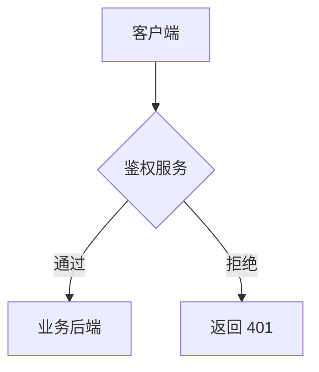

# @huahao/dsh-mermaid

简体中文 | [English](README.md)

把 DeepSeek Harness（DSH）里的 Mermaid 围栏代码块渲染为可交互 SVG。它基于
[MrmoLabs/dsh-mermaid](https://github.com/MrmoLabs/dsh-mermaid)（MIT）的架构重写定制，
针对 **DSH 0.2.2-rc.1** 的实际 DOM 契约做了适配，并补上了上游在 chat 与文件预览里
的几个缺口。

## 定制点

- **文件预览可用**：DSH 的文档预览正文复用了同一套 Markdown 渲染器，插件按
  `div.md-code-block` 结构挂载，聊天流与侧栏文件预览都能渲染。
- **读 banner 语言**：DSH 0.2.2 的 shiki 输出 `<code>` 不再带 `language-*` class，
  fence 语言只出现在 `[data-code-block-banner]` 的 infostring 文本里。插件先读
  class、再读 banner，最后才用源码首词启发式，因此 `%%{init}%%` 指令、YAML
  frontmatter、`%%` 注释开头的块也能识别，`python`/`json` 等误判被挡住。
- **接管原生围栏栏**：给命中的 `.md-code-block` 加 `data-dsh-mmd-c-host`，隐藏
  DSH 自带的语言名/复制栏（在文件预览里会产生重复的横幅），由卡片工具栏提供
  代码/图形、全屏、下载 SVG、复制五个操作。
- **原生 token 主题**：从 DSH 的 `--dsw-alias-*` 设计变量读取颜色，配合
  `theme: 'base'` + `themeVariables` 生成图表主题；深色/浅色/亚克力主题切换会
  触发重渲染。Mermaid 11 的 sequence 图不走 `themeVariables` 的 actor 颜色，
  因此额外用 `themeCSS` 按 `[aria-roledescription="sequence"]` 作用域补一层。
- **懒加载运行时**：Mermaid 11.17.2 单独打包为 ESM，由 host 半从
  `/dsh-mermaid-custom/mermaid-runtime.js?rev=<hash>` 同源提供，客户端只在第一张
  图接近视口时才 `import()`；没有 CDN、没有外联请求、没有上报。
- **流式与性能**：MutationObserver 增量发现代码块，500 ms 去抖；IntersectionObserver
  距视口 400 px 才首次渲染；缓存 32 张 SVG，主题变化时失效。
- **安全**：`securityLevel: 'strict'`、`htmlLabels: false`、SVG 经 DOMParser +
  白名单清洗后再插入；拒绝超过 50,000 字符 / 2,000 行的源码。

上游已有的全屏查看器（滚轮缩放、拖拽、Esc 关闭、焦点陷阱）、SVG 下载、源码回退、
中英文 i18n 都保留。

## 安装

本机已全局安装 `dsh` 时，把本目录安装进 Web profile：

```bash
# 在工作区构建
node scripts/build.mjs

# 从本地路径安装（会运行 prepare 重新构建）
dsh plugin --profile web add /Users/huahao/workspace/Project/github/dsh-mermaid-custom
```

安装后重启 `dsh web` 或刷新已打开的页面。在输入框让模型输出：

````markdown

````

也识别 `mermaidjs`、`mmd` fence，以及没有语言标记但首行是
`flowchart`/`graph`/`sequenceDiagram` 等关键字、或开头带 `%%` 指令 / `---` frontmatter
的块。不做行内代码。

## 验收

1. 聊天里出现卡片：代码 / 图形 / 全屏 / 下载 SVG / 复制；切换图形可看到 SVG。
2. 侧栏打开含 mermaid 的 Markdown 文件，同样出现卡片，且上方不再有 DSH 原生的
   `mermaid` 语言栏。
3. 代码块默认 300 ms 稳定后按需渲染，滚动到附近才加载运行时（Network 里只请求一次
   `/dsh-mermaid-custom/mermaid-runtime.js?rev=…`，状态 200）。
4. 切换 DSH 深色/浅色主题，图会按新 token 重渲染。
5. 含 `%%{init: {"theme":"forest"}}%%` 的块能渲染（主题仍以 DSH token 为准）。
6. `python`/`json`/`arduino` 等以 `graph` 开头的代码块保持原生代码块形态。

## 开发

```bash
pnpm install        # 只装 esbuild / happy-dom / mermaid
node scripts/build.mjs
node --test         # 51 个用例：detection / client / theme / viewer / tooltip / runtime route
```

`lib/client.js` 由 `src/*.js` 打包（CJS 入口 + `window.__ModuleLoader__.load`），
`lib/mermaid-runtime.js` 是 ESM（`mermaid` 11.17.2 + 工具函数）。`scripts/build.mjs`
会把 runtime 的 sha256 前 12 位写进客户端 `?rev=`。

## 卸载

```bash
dsh plugin --profile web remove @huahao/dsh-mermaid
```

## 兼容性

- 构建与手工验收基于 DSH `0.2.2-rc.1`（`@deepseek-ai/dsh-web-frontend` 的
  `md-code-block` / `[data-code-block-banner]` / `[data-code-block-content]` 结构）。
- 只支持 Web profile（`platform: 'web'`）；DSH Desktop 需要另行验证窗口标题栏相关的
  全屏布局。
- `package.json` 声明 `dsh.engines.dsh >=0.2.2-rc.1 <0.3.0-0`；DSH 未提供稳定的
  第三方渲染扩展点，升级后请按上面的验收步骤回归。

## 许可

MIT。基于 MrmoLabs/dsh-mermaid（Copyright © 2026 Mrmo072）修改；本仓库的改动
（banner 语言识别、host 接管、token 主题、sequence themeCSS、复制按钮、懒渲染等）
同样以 MIT 发布，详见 [LICENSE](LICENSE)。
